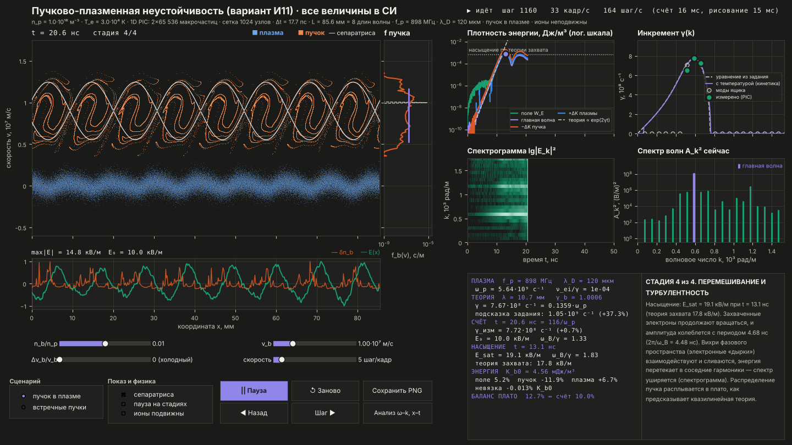

# Пучково-плазменная неустойчивость — вариант И11 (всё в СИ)

Интерактивная модель на Python: электронный пучок в плазме раскачивает
ленгмюровскую волну, волна растёт, захватывает электроны пучка, насыщается,
в фазовом пространстве образуются вихри, спектр уширяется (переход к
турбулентности), а если включить подвижные ионы — появляются каверны
(ленгмюровские солитоны), и плазма нагревается. Всё считается в реальном времени.

**Все величины — в единицах СИ**: метры, секунды, м/с, В/м, м⁻³, К, Дж/м³, рад/с,
рад/м. Плазма задаётся настоящими параметрами (концентрация n_p, температура T_e,
скорость пучка v_b), постоянные — CODATA.



## Что в модели

* **Единицы СИ** во всех формулах, осях, таблицах и в самом коде; постоянные CODATA.
* **Релятивистское движение** частиц (p = γmv), пучок до 0.97c.
* **Реальная температура плазмы**: дебаевский радиус, кинетическая теория (функция Z).
* **Подвижные ионы** с настоящей массой (галочка «ионы подвижны»): после насыщения
  появляются каверны — всплески поля в ямах концентрации; они подсвечиваются на экране.
* **Проверка допущений** на экране: ν_ei/γ (столкновений нет), невязка энергии.

## Установка и запуск

**Важно: нужна вся папка проекта, а не один `run.py`.** Программа находится в
папке `bpi/`, а `run.py` только запускает её.

### Самый простой способ (IDLE, macOS или Windows)

1. Распаковать архив `beam_plasma_I11.zip` (двойной щелчок).
2. В IDLE: File → Open → `beam_plasma_I11/run.py` (из распакованной папки).
3. Нажать **F5** (Run → Run Module).

При первом запуске программа проверит библиотеки numpy, matplotlib и scipy. Если их
нет, она предложит установить их сама (ответить «да», нужен интернет) или покажет
точную команду для Терминала.

### Из терминала

Нужен Python 3.9+ (проверено на 3.12 и 3.13).

```bash
cd beam_plasma_I11
```

```bash
python3 -m pip install -r requirements.txt
```

```bash
python3 run.py
```

(В Windows вместо `python3` — `py`.)

Параметры запуска (в СИ):

```bash
python3 run.py --alpha 0.02 --vb 2e7 --dv 1e6
```

```bash
python3 run.py --ions
```

`--np` — концентрация плазмы, м⁻³ (по умолчанию 10¹⁶); `--Te` — температура электронов, К
(3·10⁴); `--alpha` — n_b/n_p; `--vb` — скорость пучка, м/с; `--dv` — разброс скоростей
пучка, м/с; `--ions` — подвижные ионы; `--ion H+|D+|He+|Ar+|O+` — сорт ионов;
`--two-stream` — встречные пучки; `--light` — светлая тема; `--npart 32768` — вдвое
меньше частиц (для слабого компьютера).

## Что на экране

Одно главное окно: фазовый портрет (x [мм], v [м/с]) с сепаратрисой, f(v), поле E(x)
[В/м], плотности энергии [Дж/м³], спектрограмма, γ(k) [с⁻¹] с теорией и точками счёта,
спектр волн, короткая таблица главных чисел и объяснение текущей стадии. Щелчок по
любому графику показывает, что на нём и по какой формуле. Кнопка «Анализ ω–k, x–t»
открывает дисперсионную диаграмму, построенную из счёта, и карты x–t поля и ионов.

Таблица амплитуд насыщения, одноволновая модель и уравнения Захарова (солитоны)
считаются скриптом `experiments/run_experiments.py`; результаты — в `results/СВОДКА.md`.

## Что где

| файл | что внутри |
|---|---|
| `run.py` | запуск |
| `bpi/constants.py` | постоянные СИ (CODATA) и параметры плазмы: ω_p, λ_D, v_T, c_s, ν_ei, затухание Ландау |
| `bpi/units.py` | вывод чисел с приставками СИ (нс, мм, кВ/м, МГц) |
| `bpi/dispersion.py` | точное решение дисперсионного уравнения, γ(k), кинетическая теория |
| `bpi/pic.py` | 1D релятивистский PIC-код: электроны плазмы, пучок, ионы; сетка, поле, «чехарда» |
| `bpi/single_wave.py` | одноволновая модель (уравнение огибающей + частицы, Рунге–Кутта 4) |
| `bpi/zakharov.py` | уравнения Захарова: огибающая с нелинейным сдвигом частоты, солитоны, модуляционная неустойчивость |
| `bpi/diagnostics.py` | измерение γ, насыщения, баунс-частоты, сепаратриса, квазилинейный баланс, стадии, спектр (k, ω) |
| `bpi/runs.py`, `bpi/journal.py` | один эксперимент «до насыщения» и журнал всех счётов |
| `bpi/gui/` | интерфейс: главное окно и окно анализа |
| `experiments/run_experiments.py` | все вычислительные эксперименты для отчёта |
| `results/` | таблицы CSV, графики PNG, журнал, **`СВОДКА.md`** (.docx) — все результаты с числами и графиками |
| `docs/ОБЪЯСНЕНИЕ.md` (.docx, .pdf) | **полное объяснение**: вывод каждой формулы в СИ, алгоритм, интерфейс, вопросы на защите |
| `tests/` | 17 автоматических проверок: `python tests/run_all.py` |

## Как показать на защите (5 минут)

1. `python run.py`, включить «пауза на стадиях». Модель останавливается в начале
   каждой стадии — справа внизу объяснение с живыми числами в СИ; пробел — дальше.
2. «Линейный рост»: энергия идёт по прямой с наклоном 2γ, в таблице γ_изм совпадает
   с теорией (≈0.7 %), формула подсказки завышена на 37 %.
3. «Захват»: завитки пучка ложатся внутрь белой сепаратрисы; ω_B/γ ≈ 1.8;
   E_sat ≈ 19 кВ/м при n_p = 10¹⁶ м⁻³, v_b = 10⁷ м/с.
4. «Перемешивание»: спектрограмма уширяется, f(v) расплывается в плато.
5. Ползунок v_b вправо (до 2.7·10⁸ м/с): инкремент падает — релятивистский эффект.
6. Галочка «ионы подвижны», ползунок «скорость» на максимум: при t ≈ 100 нс
   появляется каверна — розовая полоса на портрете и на графике поля.
7. «Анализ ω–k, x–t»: счёт сам рисует дисперсионные кривые.

## Ключевые результаты

Числа — для лабораторного разряда: n_p = 10¹⁶ м⁻³, T_e = 3·10⁴ К, v_b = 10⁷ м/с
(ω_p = 5.64·10⁹ с⁻¹, f_p = 898 МГц, λ_D = 120 мкм). Полные таблицы — `results/СВОДКА.md`.

| что | результат |
|---|---|
| γ(k): PIC против точной теории | главная мода: +0.7 % (пучок), +0.35 % (встречные пучки), −0.5 % (пучок 0.8c); соседние моды — до 4 % |
| γ_max(n_b/n_p), 0.001…0.1 | 3.7·10⁸ … 1.5·10⁹ с⁻¹, ошибка PIC 0.04–1.3 %; закон γ_max ∝ (n_b/n_p)^0.306 |
| формула из подсказки | завышает γ на 31–49 % (пропущен множитель 2^(−1/3)) |
| насыщение | E_sat = 4.4 … 61 кВ/м, E_sat ∝ (n_b/n_p)^0.58 (PIC и теория захвата), ω_B/γ = 1.76–1.86 |
| скорость пучка | до 0.9c: γ ∝ 1/γ_b (ошибка PIC < 0.5 %), E_sat = 8.7 кВ/м … 0.83 МВ/м совпадает с теорией захвата до 2–9 % |
| тёплый пучок | γ PIC = кинетическая теория с точностью ~1 % |
| квазилинейный баланс (края плато — из счёта) | совпадение 9–26 % при n_b/n_p ≤ 0.02; при 0.05–0.1 неприменима |
| подвижные ионы H⁺ | каверны при t ≈ 98 нс (550/ω_p): W ≈ 1, яма до −25 %; энергия поля падает в 19 раз (без ионов — в 1.6) |
| рост возмущений ионов | темп в PIC 3.8·10⁷ с⁻¹; теория модуляционной неустойчивости для измеренного уровня поля W₀ = 0.15 даёт 4.8·10⁷ с⁻¹ — согласие по порядку величины |
| уравнения Захарова | точный солитон сохраняется (ΔN/N ~ 10⁻¹²), γ_мод совпадает с теорией до 0.01 % |
| сохранение | энергия 4·10⁻⁴ K_b0 (даже за 2000/ω_p с ионами), импульс 10⁻¹⁵ |

Подробно — `results/СВОДКА.md` и `docs/ОБЪЯСНЕНИЕ.md`.

## Если что-то не так

* **Медленно на слабом ноутбуке** — `python run.py --npart 32768` или уменьшить
  ползунок «скорость». Кадры/с и время кадра видны в правом верхнем углу.
* **Окно не открывается / ошибка бэкенда** — `python run.py --backend TkAgg`
  (или `QtAgg`, если установлен PyQt). В Linux может понадобиться пакет `python3-tk`.
* **`No module named 'bpi'`** — рядом с `run.py` нет папки `bpi/`: скачан один файл.
  Скачайте и распакуйте архив проекта целиком.
* **`No module named 'numpy'` (или matplotlib, scipy)** — библиотеки установлены не в
  тот Python, которым запускается программа. `run.py` покажет точную команду
  вида `"/путь/к/python3" -m pip install numpy matplotlib scipy`.
* **Из Spyder/Jupyter** — лучше из IDLE (F5) или терминала: `python3 run.py`.
