# Путеводитель по программе «Пучково-плазменная неустойчивость» (вариант И11)

Этот документ — подробная экскурсия по программе. На снимке экрана каждый элемент
пронумерован, и для каждого номера ниже написано: **что он показывает**, **как это
считается** (формула и шаг алгоритма), **где это в коде** и **что сказать
преподавателю**. Все числа взяты из настоящего счёта с параметрами по умолчанию —
они совпадают с тем, что вы увидите на экране.

Все величины в программе — в единицах СИ: метры, секунды, м/с, В/м, Дж/м³, м⁻³, К.
Подробный вывод формул — в файле `docs/ОБЪЯСНЕНИЕ.pdf`; таблицы результатов — в
`results/СВОДКА.md`.

---

## 0. Как запустить

1. Распаковать архив целиком (нужна вся папка, а не только `run.py`).
2. Открыть `run.py` в IDLE и нажать **F5** — или в терминале: `python3 run.py`.
3. С подвижными ионами: `python3 run.py --ions`. Встречные пучки: `python3 run.py --two-stream`.

Окно сразу начинает считать. Пробел — пауза.

---

## 1. Что моделируется — в двух словах

Через плазму летит пучок быстрых электронов. Плазма умеет колебаться со своей
собственной частотой (это **ленгмюровская волна**). Если волна бежит чуть медленнее
пучка, электроны пучка её догоняют, тормозятся в её поле и отдают ей энергию —
волна растёт экспоненциально. Это и есть **пучково-плазменная неустойчивость**.
Рост останавливается, когда волна становится настолько сильной, что электроны пучка
«застревают» в её потенциальных ямах (**захват**). Дальше — перемешивание,
турбулентность, а при подвижных ионах — **каверны** (ямы в плотности, где заперто поле).

**Параметры по умолчанию** (лабораторный разряд в водороде):

| величина | значение | что это |
|---|---|---|
| $n_p$ | $10^{16}$ м⁻³ | концентрация электронов плазмы |
| $T_e$ | $3\cdot10^4$ К | температура электронов плазмы |
| $n_b/n_p$ | 0.01 | пучок в 100 раз реже плазмы ($n_b=10^{14}$ м⁻³) |
| $v_b$ | $10^7$ м/с $=0.033c$ | скорость пучка |
| ионы | неподвижны (галочка — подвижные H⁺, $T_i=3\cdot10^3$ К) | |

**Что из них получается:**

| величина | формула | значение |
|---|---|---|
| плазменная частота | $\omega_p=\sqrt{n_pe^2/(\varepsilon_0m)}$ | $5.64\cdot10^9$ рад/с ($f_p=898$ МГц) |
| период плазменных колебаний | $2\pi/\omega_p$ | 1.11 нс |
| тепловая скорость электронов | $v_{Te}=\sqrt{k_BT_e/m}$ | $6.74\cdot10^5$ м/с (в 15 раз меньше $v_b$) |
| дебаевский радиус | $\lambda_D=v_{Te}/\omega_p$ | 120 мкм |
| длина самой неустойчивой волны | $\lambda=2\pi/k_{max}$ | 10.7 мм |
| инкремент (скорость роста) | $\gamma$ | $7.67\cdot10^8$ с⁻¹, амплитуда растёт в $e$ раз за 1.3 нс |
| поле насыщения | $E_{sat}$ | 19.1 кВ/м |

**Метод — «частицы в ячейках» (PIC).** Плазма и пучок представлены 65 536
«макрочастицами» каждого сорта. Каждая макрочастица заменяет $1.3\cdot10^{10}$
настоящих электронов на 1 м² сечения. На каждом шаге (17.7 пс) программа: считает,
сколько частиц в каждой из 1024 ячеек сетки → находит из этого электрическое поле →
вычисляет силу, действующую на каждую частицу → сдвигает частицы. Подробно — раздел 6.

---

## 2. Главное окно: карта

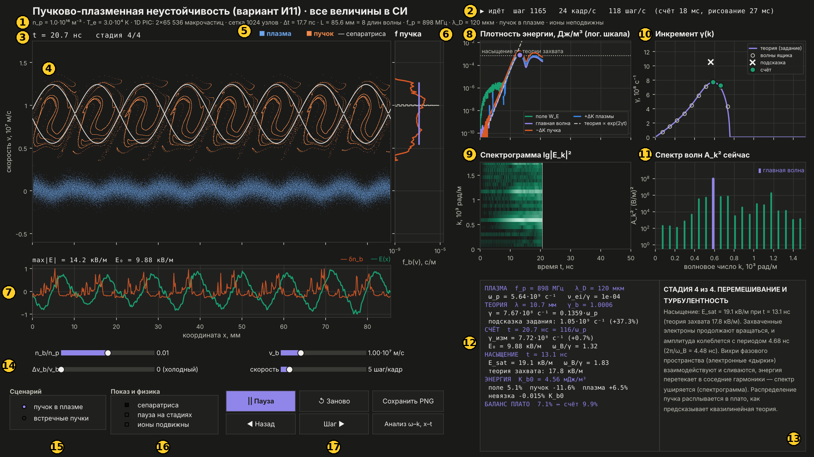{width=100%}

| № | элемент | одной строкой |
|---|---|---|
| 1 | заголовок и строка параметров | какая плазма и какая сетка сейчас считаются |
| 2 | строка состояния | идёт ли счёт и с какой скоростью |
| 3 | время и стадия | сколько прошло нс и на какой стадии процесс |
| 4 | фазовый портрет | все частицы на плоскости «координата — скорость» |
| 5 | легенда цветов | синий — плазма, оранжевый — пучок, белая линия — сепаратриса |
| 6 | f пучка | сколько электронов пучка с какой скоростью |
| 7 | поле E(x) | напряжённость поля и сгустки пучка вдоль ящика |
| 8 | плотность энергии | кто сколько энергии получил и отдал |
| 9 | спектрограмма | какие волны когда растут |
| 10 | инкремент γ(k) | теория против счёта: насколько быстро растёт каждая волна |
| 11 | спектр волн | сила каждой волны прямо сейчас |
| 12 | таблица чисел | главные числа: теория, измерения, энергия |
| 13 | пояснение | что происходит сейчас (или что на графике, по которому щёлкнули) |
| 14 | ползунки | параметры пучка и скорость анимации |
| 15 | сценарий | пучок в плазме или встречные пучки |
| 16 | показ и физика | сепаратриса, пауза на стадиях, подвижные ионы |
| 17 | кнопки | пауза, заново, назад, шаг, снимок, окно анализа |

---

## 3. Каждый элемент подробно

### 3.1. ① Заголовок и строка параметров

Строка под заголовком расшифровывается так:

| фрагмент | смысл |
|---|---|
| `n_p = 1.0·10¹⁶ м⁻³ · T_e = 3.0·10⁴ К` | параметры плазмы (задаются при запуске: `--np`, `--Te`) |
| `1D PIC: 2×65 536 макрочастиц` | два сорта частиц (плазма и пучок), по 65 536 каждого; с ионами — три сорта |
| `сетка 1024 узлов` | ящик разбит на 1024 ячейки, $\Delta x=83.6$ мкм $=0.7\lambda_D$ |
| `Δt = 17.7 пс` | шаг по времени $=0.1/\omega_p$: на один период плазменных колебаний приходится 63 шага |
| `L = 85.6 мм = 8 длин волны` | длина ящика: в нём ровно 8 длин самой неустойчивой волны |
| `f_p = 898 МГц · λ_D = 120 мкм` | плазменная частота и дебаевский радиус |
| `пучок в плазме · ионы неподвижны` | выбранный сценарий |

**Почему ящик ровно 8 длин волны.** Ящик периодический: что вылетело справа,
влетает слева. В нём могут жить только волны, которые укладываются целое число раз:
$k_m=2\pi m/L$. Длина подобрана так, чтобы самая неустойчивая по теории волна была
одной из них ($m=8$) — тогда именно она вырастет первой, и на портрете будет 8 вихрей.

**Почему $\Delta x<\lambda_D$.** Если ячейка много больше дебаевского радиуса, PIC-код
искусственно нагревает плазму (численный нагрев). При $\Delta x=0.7\lambda_D$ этого нет.

### 3.2. ② Строка состояния

`▶ идёт  шаг 1165  24 кадр/с  118 шаг/с  (счёт 18 мс, рисование 27 мс)`

- **▶ идёт / || пауза** — состояние счёта.
- **шаг** — сколько шагов по времени сделано.
- **кадр/с, шаг/с** — скорость анимации; за кадр делается столько шагов, сколько
  стоит на ползунке «скорость».
- **счёт / рисование** — сколько миллисекунд уходит на физику и на картинку в одном кадре.

Иногда здесь появляется сообщение: «перемотано на t = …», «сохранено: results/…»,
«пауза: новая стадия» или предупреждение, если пучок слишком медленный
($v_b<4v_{Te}$: он тонет в тепловом разбросе плазмы и почти не раскачивает волну).

**Что сказать:** «Всё считается вживую, это видно по счётчику шагов и времени кадра».

### 3.3. ③ Время и стадия

`t = 20.7 нс   стадия 4/4` — физическое время с начала счёта и номер стадии
(из 4 без ионов, из 5 с ионами). Стадию программа определяет **сама, по счёту**:

| стадия | когда начинается | по умолчанию |
|---|---|---|
| 1. Затравка | с начала | 0 |
| 2. Линейный рост | $t=4/\gamma$ — нерастущие решения стали в $e^4\approx55$ раз слабее растущего | 5.2 нс |
| 3. Захват | амплитуда главной волны превысила 30 % от уровня захвата | 10.4 нс |
| 4. Перемешивание | пройден первый максимум амплитуды (она упала на 15 % от максимума) | 13.9 нс (сам максимум — 13.1 нс) |
| 5. Каверны (только с ионами) | среднеквадратичное возмущение концентрации ионов больше 2 % | ≈ 97 нс |

Пороги 30 %, 15 % и 2 % — условные; они выбраны так, чтобы стадии совпадали с тем,
что видно глазом. На физику они не влияют, только на подпись.

### 3.4. ④ Фазовый портрет — главный график

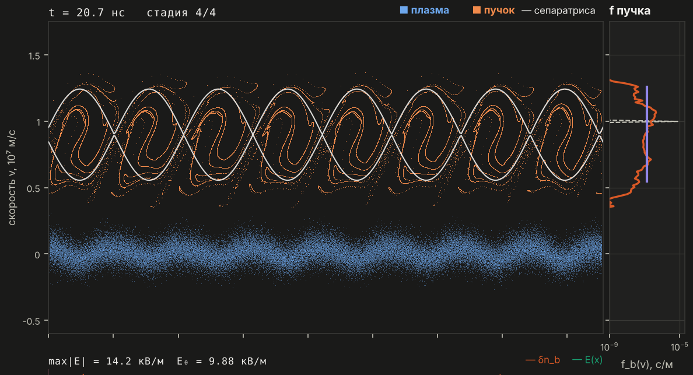{width=100%}

**Что показывает.** Каждая точка — макрочастица. По горизонтали — её координата $x$
(мм), по вертикали — скорость $v$ ($10^7$ м/с). Синие — электроны плазмы: они почти
стоят ($v\approx0$, тепловой разброс ±0.07·10⁷ м/с) и качаются в поле волны.
Оранжевые — электроны пучка: стартуют с $v_b=1\cdot10^7$ м/с.

**Как рисуется.** Картинка строится сразу в пикселях экрана: для каждого пикселя
считается, сколько частиц в него попало (двумерная гистограмма), яркость $\propto\sqrt{N}$,
цвет смешивается из синего и оранжевого по готовой таблице. Так 131 тысяча частиц
рисуется за пару миллисекунд.

**Белая линия — сепаратриса** — граница потенциальной ямы главной волны. Поле
главной волны $E=E_0\cos(kx+\varphi)$ создаёт для электрона потенциальную энергию
$U=(eE_0/k)\sin(kx+\varphi)$. В системе отсчёта, которая бежит вместе с волной
(фазовая скорость $v_\phi=\omega_r/k=8.99\cdot10^6$ м/с), граница захвата при $v\ll c$:
$$(v-v_\phi)^2=\frac{2eE_0}{mk}\big(1-\sin(kx+\varphi)\big).$$
В программе используется точная релятивистская формула. Полуширина ямы
$2\sqrt{eE_0/(mk)}$: при $E_0=19.1$ кВ/м это $4.8\cdot10^6$ м/с — почти половина скорости
пучка. Частица внутри «глаза» захвачена и вращается вокруг дна ямы с частотой
$\omega_B=\sqrt{ekE_0/m}=1.40\cdot10^9$ с⁻¹ — отсюда завитки.

**Что сказать:** «Завитки внутри сепаратрисы — это захваченные волной электроны
пучка. Это вихри в фазовом пространстве — когерентные структуры из задания».

### 3.5. ⑤ Легенда цветов

Цвета одинаковы во всех окнах:

| цвет | что |
|---|---|
| синий | электроны плазмы |
| оранжевый | электроны пучка |
| бирюзовый | электрическое поле, волны |
| фиолетовый | главная (самая неустойчивая) волна, теория γ(k) |
| розовый | ионы, каверна |
| серый пунктир | теоретические кривые |

### 3.6. ⑥ f пучка — функция распределения по скоростям

**Что показывает.** Какая доля электронов пучка имеет данную скорость. Ось скоростей
общая с фазовым портретом. Ось $f$ логарифмическая, единица — с/м (доля на 1 м/с),
нормировка $\int f\,dv=1$.

- **серый пунктир** — начальное распределение: узкий пик на $v_b$ (холодный пучок);
- **оранжевая** — распределение сейчас;
- **фиолетовая вертикаль** (появляется на 4-й стадии) — «плато» по квазилинейной
  теории: $f=\text{const}=1/(v_2-v_1)$ на отрезке $[v_1,v_2]$.

**Как считается.** Гистограмма скоростей электронов пучка по 180 интервалам. Края
плато $v_1,v_2$ — там, где $f$ падает до половины высоты плато.

**Что сказать:** «Пучок тормозится и расплывается в плато — это предсказывает
квазилинейная теория. Края плато используются в балансе энергии в таблице».

### 3.7. ⑦ Поле E(x), группировка пучка, ионы

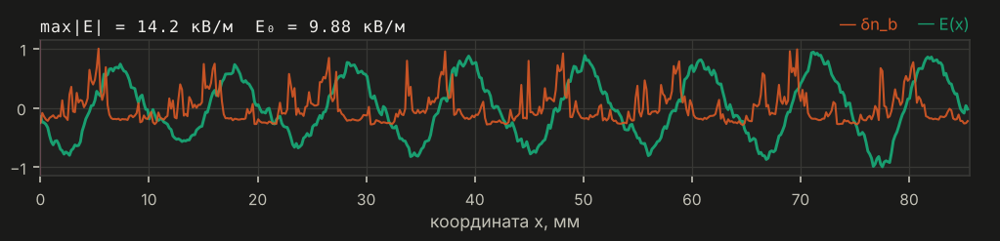{width=100%}

**Линии** (каждая нормирована на свой максимум, поэтому все в пределах ±1):

- **бирюзовая** — напряжённость поля $E(x)$;
- **оранжевая** — возмущение концентрации пучка $\delta n_b(x)$: сгустки и разрежения;
- **розовая** (только с ионами) — возмущение концентрации ионов $\delta n_i/n_i$.

**Строка над графиком:** `max|E| = 14.2 кВ/м  E₀ = 9.88 кВ/м` — наибольшее поле в ящике
и амплитуда главной волны.

**Как считается поле.** Из теоремы Гаусса в одномерном виде $\partial E/\partial x=\rho/\varepsilon_0$.
Плотность заряда $\rho=e(n_i-n_e)$ раскладывается в ряд Фурье (БПФ), и для каждой
гармоники $E_k=\rho_k/(ik\varepsilon_0)$. Амплитуда главной волны $E_0=2|E_{k_8}|/N_g$ берётся
прямо из этой же гармоники.

**Что видно.** Сгустки пучка сидят там, где поле тормозит электроны ($E>0$, сила
$-eE<0$). Так пучок и отдаёт энергию волне.

**Розовая полоса — каверна** (только с ионами):

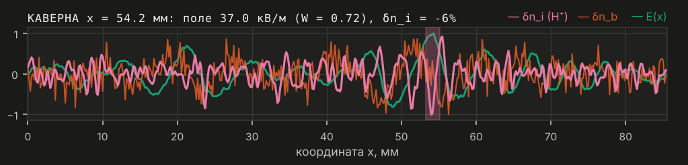{width=100%}

Полоса появляется, когда в одном месте одновременно: уровень поля
$W=\varepsilon_0\langle E^2\rangle/(2nk_BT_e)>0.3$ и концентрация ионов понижена больше чем на 5 %.
$W$ — отношение плотности энергии поля к тепловой энергии электронов;
$\langle E^2\rangle$ усредняется по периоду плазменных колебаний. Тогда строка над
графиком заменяется на `КАВЕРНА x = 54.2 мм: поле 37.0 кВ/м (W = 0.72), δn_i = −6%`.
Пороги 0.3 и 5 % условные. Полоса — про одно место, а стадия 5 — про весь ящик,
поэтому полоса может появиться раньше (здесь 87 нс), чем стадия 5 (≈ 97 нс).

### 3.8. ⑧ Плотность энергии

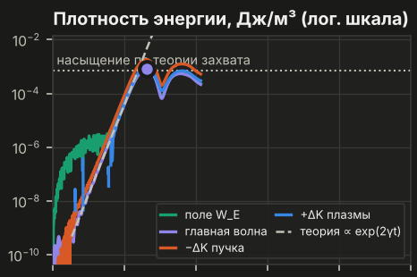{width=80%}

Шкала энергии логарифмическая, единица — Дж/м³ (энергия в 1 м³).

| линия | формула | смысл |
|---|---|---|
| поле $W_E$ (бирюзовая) | $\varepsilon_0\langle E^2\rangle/2$ | энергия всего электрического поля |
| главная волна (фиолетовая) | $\varepsilon_0E_0^2/4$ | только волна $m=8$ |
| $-\Delta K$ пучка (оранжевая) | $K=n\langle(\gamma-1)mc^2\rangle$ | сколько энергии потерял пучок |
| $+\Delta K$ плазмы (синяя) | | сколько получили электроны плазмы |
| теория (серый пунктир) | $\propto e^{2\gamma t}$ | линейная теория; на лог-шкале — прямая |
| точечная горизонталь | $\varepsilon_0E_{захв}^2/4$ | уровень насыщения по теории захвата |
| фиолетовая точка | | момент насыщения — первый максимум |

**Почему $2\gamma$:** энергия $\propto E^2$, а $E\propto e^{\gamma t}$.

**Шум в начале** (зелёный «ворс» на уровне $10^{-7}\ldots10^{-6}$ Дж/м³) — тепловые флуктуации плазмы:
частиц конечное число. Главная волна вырастает из-под этого шума.

**Закон сохранения:** потеря пучка = энергия поля + прирост энергии плазмы. Разница
(невязка) — в таблице, $-0.015\,\%$ от начальной энергии пучка. Это главная проверка,
что счёт правильный.

**Что сказать:** «Прямой участок — экспоненциальный рост, наклон совпадает с теорией.
Рост останавливается на уровне теории захвата».

### 3.9. ⑨ Спектрограмма

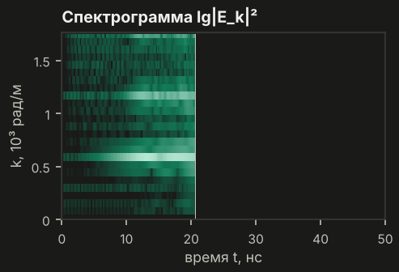{width=60%}

**Что показывает.** По горизонтали — время, по вертикали — волновое число $k$,
яркость — $\lg|E_k|^2$, то есть сила каждой волны в каждый момент.

**Как считается.** Поле на каждом шаге раскладывается на 48 волн ящика
($k_m=2\pi m/L$, $m=1\ldots48$); их амплитуды запоминаются. Ось времени разбита на 300
столбцов; в каждом — амплитуды всех волн в этот момент. Белая вертикаль — «сейчас».
Когда время доходит до края, ось удлиняется в 1.5 раза.

**Что видно.** Сначала ярче всех полоса $k\approx587$ рад/м (главная волна). После
насыщения загорается её вторая гармоника ($2k\approx1175$ рад/м) и соседние $k$ —
энергия расползается по спектру. Это и есть переход к турбулентности.

### 3.10. ⑩ Инкремент γ(k)

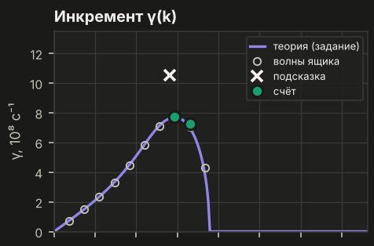{width=70%}

**γ** — скорость роста волны: амплитуда растёт как $e^{\gamma t}$.

- **Сплошная линия «теория (задание)»** — точное решение дисперсионного уравнения
  из задания
  $$1-\frac{\omega_p^2}{\omega^2}-\frac{\omega_b^2}{(\omega-kv_b)^2}=0 .$$
  После умножения на $\omega^2(\omega-kv_b)^2$ это многочлен 4-й степени по $\omega$. Его
  4 корня находятся точно (как собственные числа сопровождающей матрицы — тот же
  способ, что в `numpy.roots`), и $\gamma=\max\mathrm{Im}\,\omega$.
- **Пунктир «кинетика»** появляется, только если температура плазмы или разброс
  скоростей пучка меняют γ больше чем на 3 %. По умолчанию разница 0.3 %, и пунктира нет.
- **Кружки** — волны, которые укладываются в ящик и растут.
- **Зелёные точки «счёт»** — γ, измеренный в самом счёте; вертикальный отрезок — погрешность.
- **Крестик «подсказка»** — оценка из подсказки задания:
  $k=\omega_p/v_b$, $\gamma=(\sqrt3/2)(n_b/n_p)^{1/3}\omega_p=1.05\cdot10^9$ с⁻¹. Она на 37 % выше
  точной кривой: в подсказке пропущен множитель $2^{-1/3}$.

**Как измеряется γ в счёте.** Для каждой волны берётся логарифм её амплитуды на
отрезке линейной стадии — от $4/\gamma$ до момента, когда главная волна достигла 5 %
уровня насыщения, — и проводится прямая методом наименьших квадратов. Наклон прямой
и есть γ. **Погрешность:** тот же отрезок делится пополам, γ измеряется по каждой
половине, погрешность — половина разницы.

| волна | γ теория, с⁻¹ | γ счёт, с⁻¹ | отличие | погрешность | на графике |
|---|---|---|---|---|---|
| m = 8 (главная) | $7.67\cdot10^8$ | $7.72\cdot10^8$ | +0.7 % | ±0.06 % | да |
| m = 9 | $7.05\cdot10^8$ | $7.25\cdot10^8$ | +2.7 % | ±4.1 % | да |
| m = 7 | $7.08\cdot10^8$ | $6.52\cdot10^8$ | −8.0 % | ±24 % | нет |
| m = 6 | $5.81\cdot10^8$ | $6.66\cdot10^8$ | +15 % | ±20 % | нет |

Волны с погрешностью больше 10 % не показываются. Соседние волны затравлены в 10 раз
слабее главной и за короткую линейную стадию (около двух e-кратных ростов) не успевают
выделиться из шума. Проверка всех волн при одинаковой затравке — эксперимент E1 в
`results/СВОДКА.md` (там тоже указана погрешность каждой точки).

**Что сказать:** «Точки счёта ложатся на точное решение уравнения из задания.
Формула подсказки завышает инкремент на 37 %».

### 3.11. ⑪ Спектр волн сейчас

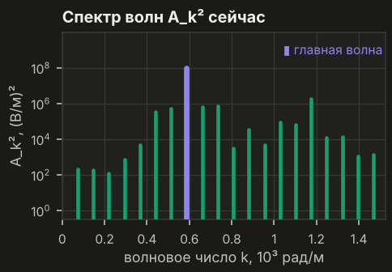{width=60%}

Квадрат амплитуды каждой из 48 волн ящика прямо сейчас, (В/м)², логарифмическая шкала.
Фиолетовая — главная волна. В линейной стадии форма спектра повторяет γ(k): быстрее
растут волны с большим γ. После насыщения вырастают гармоники $2k$, $3k$ и соседи —
спектр уширяется.

### 3.12. ⑫ Таблица чисел — построчно

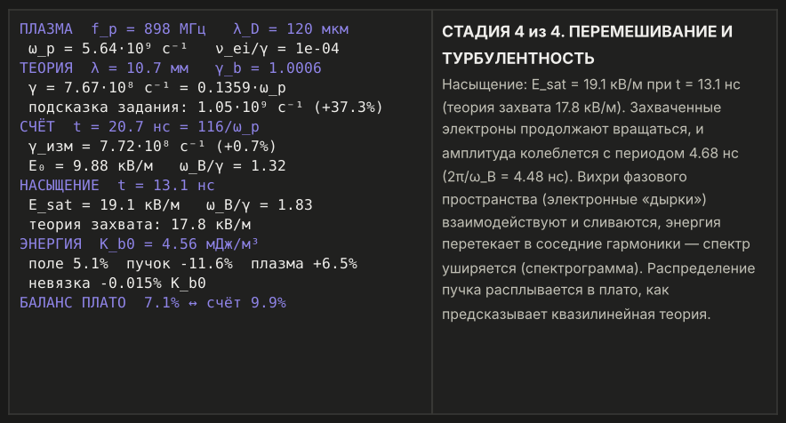{width=100%}

| строка | что значит | откуда |
|---|---|---|
| **ПЛАЗМА** `f_p = 898 МГц, λ_D = 120 мкм` | плазменная частота и дебаевский радиус | $f_p=\omega_p/2\pi$, $\lambda_D=v_{Te}/\omega_p$ |
| `ω_p = 5.64·10⁹ с⁻¹  ν_ei/γ = 1e-04` | частота столкновений электронов с ионами в 10 000 раз меньше γ | формула Спитцера; значит, столкновениями можно пренебречь |
| **ТЕОРИЯ** `λ = 10.7 мм  γ_b = 1.0006` | длина самой неустойчивой волны и лоренц-фактор пучка | $\lambda=2\pi/k_{max}$, $\gamma_b=1/\sqrt{1-v_b^2/c^2}$ |
| `γ = 7.67·10⁸ с⁻¹ = 0.1359·ω_p` | теоретический инкремент главной волны ящика (с учётом температуры) | корень дисперсионного уравнения |
| `подсказка задания: 1.05·10⁹ (+37.3%)` | формула из подсказки и насколько она завышена | $(\sqrt3/2)(n_b/n_p)^{1/3}\omega_p$ |
| **СЧЁТ** `t = 20.7 нс = 116/ω_p` | время в наносекундах и в периодах $1/\omega_p$ | |
| `γ_изм = 7.72·10⁸ с⁻¹ (+0.7%)` | измеренный инкремент главной волны и отличие от теории; «…» — ещё измеряется | наклон $\ln E_0(t)$ (МНК) |
| `E₀ = 9.88 кВ/м  ω_B/γ = 1.32` | амплитуда главной волны сейчас и её баунс-частота в единицах γ | $\omega_B=\sqrt{ekE_0/m}$ |
| **НАСЫЩЕНИЕ** `t = 13.1 нс` | момент первого максимума амплитуды | |
| `E_sat = 19.1 кВ/м  ω_B/γ = 1.83` | амплитуда в максимуме; к этому моменту захваченные электроны прошли ≈ пол-оборота в яме | |
| `теория захвата: 17.8 кВ/м` | оценка $E_{sat}=3.12\,\gamma^2m/(ek)$ | см. раздел 8 |
| **ЭНЕРГИЯ** `K_b0 = 4.56 мДж/м³` | начальная плотность кинетической энергии пучка | $n_b(\gamma_b-1)mc^2$ |
| `поле 5.1%  пучок −11.6%  плазма +6.5%` | куда ушла энергия пучка (в долях $K_{b0}$) | |
| `невязка −0.015% K_b0` | насколько нарушен закон сохранения энергии | должна быть мала |
| **БАЛАНС ПЛАТО** `7.1% ↔ счёт 9.9%` | энергия поля по квазилинейной теории и в счёте | $W_E^{КЛ}=(K_{b0}-K_{плато})/2$ |
| **ИОНЫ** (если включены) | наибольший уровень поля $W$ и самая глубокая яма концентрации ионов | |

Про «баланс плато»: края плато берутся из самого счёта, поэтому это проверка баланса
энергии, а не независимое предсказание. Половина энергии ленгмюровской волны — поле,
половина — колебания электронов плазмы; отсюда деление на 2.

### 3.13. ⑬ Панель пояснения

Справа внизу — что происходит на текущей стадии, с живыми числами из счёта.
**Если щёлкнуть мышью по любому графику**, здесь появится объяснение этого графика;
пробел возвращает к пояснению стадии.

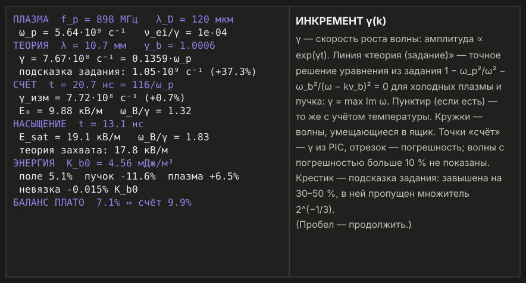{width=100%}

Текст разбивается на строки по реально измеренной ширине букв и никогда не выходит
за край панели (это проверяется автоматическим тестом).

### 3.14. ⑭ Ползунки

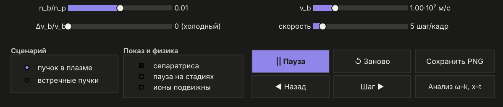{width=100%}

| ползунок | диапазон | что меняет |
|---|---|---|
| `n_b/n_p` | 0.001 … 0.1 | плотность пучка. Больше → быстрее рост ($\gamma\propto(n_b/n_p)^{0.31}$) и сильнее поле насыщения |
| `v_b` | $2\cdot10^6$ … $2.9\cdot10^8$ м/с | скорость пучка; выше $0.05c$ показывается доля от $c$. При $v_b\ll c$ меняет только масштаб; при $v_b\to c$ рост замедляется в $\gamma_b$ раз (релятивизм) |
| `Δv_b/v_b` | 0 … 0.3 | тепловой разброс скоростей пучка. Примерно от $(n_b/2n_p)^{1/3}\approx0.17$ и выше ярких вихрей нет: волна растёт медленно и плавно выходит на плато |
| `скорость` | 1 … 40 шагов за кадр | только скорость анимации, на физику не влияет |

Счёт перезапускается, когда отпускаете мышь. Концентрация и температура плазмы
меняются только при запуске (`--np`, `--Te`).

### 3.15. ⑮ Сценарий

- **пучок в плазме** — основной случай из задания.
- **встречные пучки** — два одинаковых потока электронов летят навстречу со скоростями
  $\pm v_b/2$. Это то же уравнение из задания при $\omega_{p1}=\omega_{p2}$ (двухпотоковая
  неустойчивость). Рост быстрее: $\gamma_{max}=\omega_{p}/2=2.82\cdot10^9$ с⁻¹; волна стоячая;
  образуется цепочка вихрей вокруг $v=0$.

### 3.16. ⑯ Показ и физика

- **сепаратриса** — показать или скрыть белую линию.
- **пауза на стадиях** — программа сама останавливается в начале каждой стадии
  (удобно на защите; пробел — дальше).
- **ионы подвижны** — ионы водорода становятся третьим сортом частиц с настоящей
  массой ($m_i/m_e=1836$, $T_i=3\cdot10^3$ К). До насыщения они не успевают сдвинуться,
  поэтому первые четыре стадии те же. После насыщения появляется пятая стадия —
  каверны. Чтобы дойти до неё быстрее, поставьте «скорость» на максимум.

### 3.17. ⑰ Кнопки и клавиши

| кнопка | клавиша | что делает |
|---|---|---|
| \|\| Пауза / ▶ Пуск | пробел | остановить / продолжить |
| ↺ Заново | r | начать счёт сначала с текущими параметрами |
| ◀ Назад | ← | перемотка назад: каждые 200 шагов (3.5 нс) состояние запоминается; счёт детерминирован, повтор даёт ровно те же числа |
| Шаг ▶ | → | один кадр (столько шагов, сколько на ползунке «скорость») и пауза |
| Сохранить PNG | | снимок окна в `results/снимок_дата_время.png` |
| Анализ ω–k, x–t | | отдельное окно анализа (раздел 5) |
| | f | окно во весь экран |
| щелчок по графику | | объяснение этого графика в панели ⑬ |

---

## 4. Пять стадий на фазовом портрете

#### Стадия 1. Затравка — t = 2.7 нс

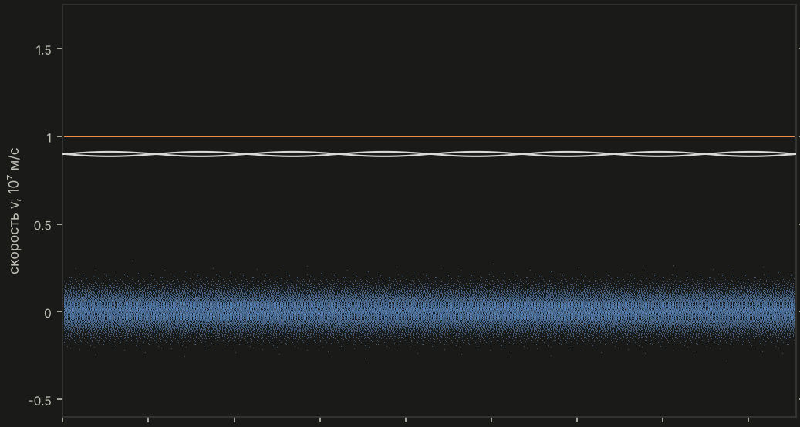{width=72%}

Пучок — ровная оранжевая линия на $v_b$, плазма — синяя полоса около нуля.
Концентрация пучка слегка промодулирована ($\delta n_b/n_b=10^{-4}$) — это «затравка»,
из которой растёт волна. Сепаратриса пока тонкая: волна слабая.

#### Стадия 2. Линейный рост — t = 9.7 нс

{width=72%}

Линия пучка начинает волниться: электроны пучка группируются в сгустки, волна растёт
как $e^{\gamma t}$. Сепаратриса расширяется.

#### Стадия 3. Захват — t ≈ 13.9 нс (сразу после максимума)

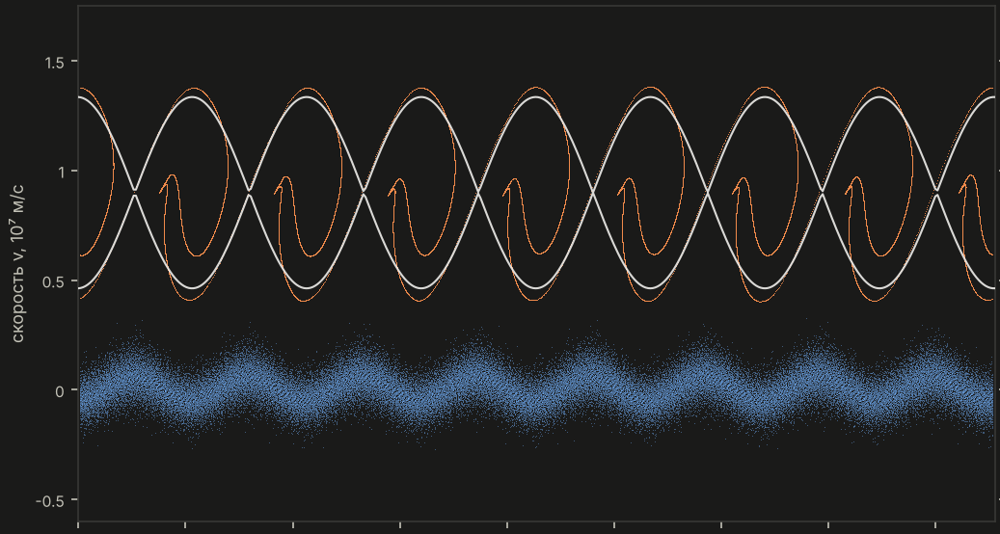{width=72%}

Яма волны стала глубже, чем электроны пучка могут «перепрыгнуть»: они разворачиваются
и начинают вращаться внутри сепаратрисы — видны «крючки». Пройдя примерно пол-оборота,
сгустки переходят в ускоряющую фазу поля и начинают отбирать энергию обратно — рост
останавливается (насыщение, $E_{sat}=19.1$ кВ/м при 13.1 нс).

#### Стадия 4. Перемешивание и турбулентность — t = 35 нс

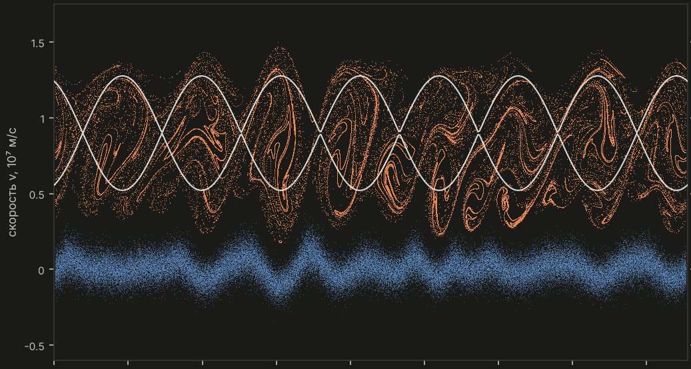{width=72%}

Вихри закручиваются, взаимодействуют и сливаются, энергия расползается по соседним
волнам (спектрограмма), пучок расплывается по скоростям в плато.

#### Стадия 5. Каверны — только с подвижными ионами, t = 87 нс

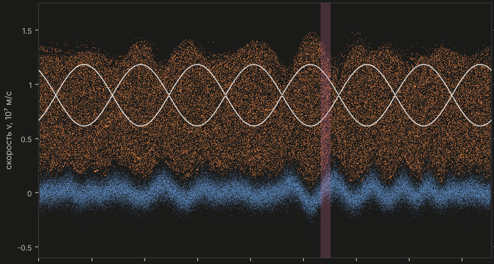{width=72%}

Сильная волна своим давлением выталкивает плазму: в концентрации ионов появляются ямы,
и поле запирается в них. Розовая полоса отмечает такое место. Дальше каверна
сжимается, волны в ней поглощаются электронами, энергия поля падает примерно в 19 раз,
плазма нагревается. (На этом снимке подпись ещё «стадия 4/5»: полоса появляется
раньше, чем возмущение ионов во всём ящике превысит порог стадии 5 — см. п. 3.7.)

---

## 5. Окно «Анализ ω–k, x–t»

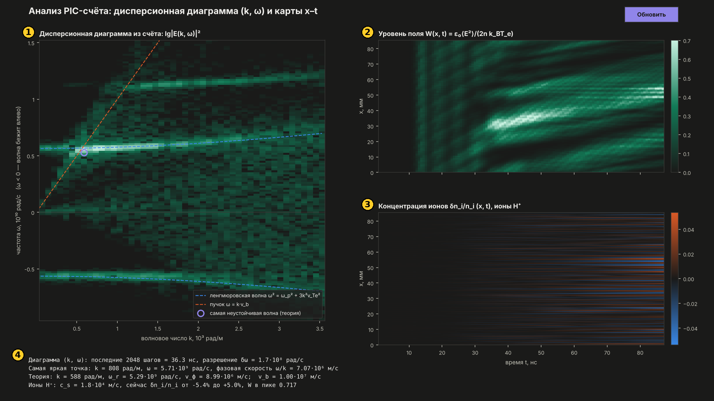{width=100%}

Окно берёт данные из того же счёта, что идёт в главном окне, и обновляется раз в секунду.

**① Дисперсионная диаграмма из счёта.** Берутся амплитуды 48 волн ящика за последние
2048 шагов (36 нс), умножаются на окно Ханна и раскладываются в ряд Фурье по времени.
Получается яркость $|E(k,\omega)|^2$ на плоскости «волновое число — частота». Счёт сам
«рисует» дисперсионные кривые:

- светится ленгмюровская ветвь $\omega^2=\omega_p^2+3k^2v_{Te}^2$ (синий пунктир — теория);
- оранжевый пунктир — пучок $\omega=kv_b$;
- кружок — самая неустойчивая волна по теории. Она стоит там, где пучковая линия
  пересекает ленгмюровскую: это и есть условие резонанса;
- $\omega<0$ — волны, бегущие навстречу пучку. Они есть и без ионов, с ионами сильнее;
- горизонтальная полоса около $1.1\cdot10^{10}$ рад/с — вторая гармоника $2\omega_p$.

Разрешение по частоте $\delta\omega=2\pi/(\text{длина окна})=1.7\cdot10^8$ рад/с.

**② Карта уровня поля $W(x,t)$.** Каждые $2/\omega_p$ (0.35 нс) добавляется строка
$W(x)=\varepsilon_0\langle E^2\rangle/(2nk_BT_e)$. Яркие полосы — волновые пакеты; наклон
полосы — скорость, с которой пакет движется вдоль ящика.

**③ Карта концентрации ионов $\delta n_i/n_i(x,t)$.** Синие полосы — ямы концентрации,
красные — уплотнения. Без ионов — пусто. С ионами после насыщения появляются тонкие
ямы — будущие каверны.

**④ Текст:** параметры окна Фурье, самая яркая точка диаграммы и теория для
сравнения, параметры ионов (скорость ионного звука $c_s=\sqrt{k_B(T_e+3T_i)/m_i}=1.8\cdot10^4$ м/с).

---

## 6. Как устроен один шаг счёта (что делает компьютер)

Уравнения (СИ):
$$\frac{dx_j}{dt}=v_j,\qquad \frac{dp_j}{dt}=q_sE(x_j),\quad p=\gamma m_sv,\qquad
\frac{\partial E}{\partial x}=\frac{\rho}{\varepsilon_0}.$$

1. **Плотность на сетке (взвешивание CIC).** Частица между узлами $i$ и $i+1$ отдаёт
   в узел $i$ долю $(1-f)$, в узел $i+1$ — долю $f$, где $f=x/\Delta x-i$. Так за одну
   операцию получается концентрация каждого сорта в 1024 узлах.
2. **Поле.** Плотность заряда $\rho=\sum q_sn_s$ раскладывается в ряд Фурье (БПФ),
   $E_k=F(k)\,\rho_k/(ik\varepsilon_0)$. $F(k)=\cos^4(k\Delta x/2)$ — сглаживание, которое
   убирает шум сетки и почти не трогает рабочие волны ($F=0.999$ для главной).
3. **Поле в точке частицы** — теми же весами: $E(x_j)=(1-f)E_i+fE_{i+1}$. Одинаковые
   веса в пп. 1 и 3 означают, что частица не действует сама на себя и **импульс
   сохраняется точно**.
4. **Импульс:** $u^{n+1/2}=u^{n-1/2}+(q_s/m_s)E\,\Delta t$, где $u=\gamma v$.
5. **Скорость и координата:** $v=u/\sqrt{1+u^2/c^2}$ (поэтому никогда $v>c$),
   $x^{n+1}=x^n+v\,\Delta t$; вылетевшие за край возвращаются с другой стороны.

Импульсы хранятся в полуцелые моменты времени, координаты — в целые (схема
«чехарда»). Схема второго порядка точности, устойчива при $\omega_p\Delta t<2$; у нас 0.1.

**Начальные условия.** Частицы стоят равномерно («тихий старт» — шум в сотни раз
меньше случайной расстановки). Тепловые скорости — точные квантили нормального
распределения. Плотность пучка промодулирована: главная волна $10^{-4}$, остальные
волны в 10 раз слабее.

**На каждом шаге записывается:** энергия поля, кинетическая энергия и импульс
каждого сорта, комплексные амплитуды 48 волн. Из этой истории строятся графики
энергии, спектрограмма, γ(k) и диаграмма в окне анализа.

**Где в коде:** `bpi/pic.py` — класс `PIC`, методы `_deposit_and_solve` (пп. 1–2),
`_gather` (п. 3), `step` (пп. 4–5).

---

## 7. Как устроен один кадр анимации

Каждые ~10 мс таймер вызывает `tick` (`bpi/gui/main_window.py`):

1. `sim.step(n)` — n шагов счёта (n — ползунок «скорость»);
2. `tracker.update()` — определение стадии, измерение γ, поиск насыщения;
3. `_update_artists()` — новые данные для всех линий и чисел;
4. `blit.update()` — перерисовка только того, что изменилось.

Почему не тормозит: физика векторизована (numpy, без циклов по частицам);
неподвижный фон (оси, подписи) рисуется один раз и запоминается; фазовый портрет и
таблица чисел пишутся прямо в пиксели; правая половина окна обновляется через кадр.

---

## 8. Откуда берутся «теоретические» числа

| число на экране | как получено |
|---|---|
| γ(k), $k_{max}$, $\omega_r$ | точные корни многочлена 4-й степени (раздел 3.10); максимум по $k$ уточняется методом золотого сечения |
| кинетическая γ (с температурой) | корень $\varepsilon(\omega,k)=1+\sum\frac{\omega_s^2}{k^2v_{Ts}^2}[1+\zeta Z(\zeta)]=0$, $Z$ — функция дисперсии плазмы; метод Ньютона из трёх начальных точек, берётся корень с наибольшим $\mathrm{Im}\,\omega$ |
| подсказка | $(\sqrt3/2)(n_b/n_p)^{1/3}\omega_p$ — как в задании; правильная асимптотика $(\sqrt3/2)(n_b/2n_p)^{1/3}\omega_p$ |
| теория захвата | $E_{sat}=3.12\,\gamma^2m\gamma_\phi^3/(ek)$. Число 3.12 $=(1.77)^2$ получено одноволновой моделью (одна волна + частицы пучка, метод Рунге–Кутты): в ней после масштабирования не остаётся параметров, поэтому $\omega_B/\gamma=1.77$ при любом пучке |
| сепаратриса | сохранение энергии частицы в системе отсчёта волны (раздел 3.4) |
| баланс плато | энергия пучка с плоским распределением $n_bm(v_1^2+v_1v_2+v_2^2)/6$; отданное пополам между полем и плазмой |
| $\nu_{ei}$ | формула Спитцера с кулоновским логарифмом $\ln\Lambda=13.4$ |

Солитоны в отчёте посчитаны отдельно — уравнениями огибающей с нелинейным сдвигом
частоты (уравнения Захарова, `bpi/zakharov.py`, эксперимент E9): точный солитон
сохраняет форму и скорость, а однородная волна распадается на каверны.

---

## 9. Что показать преподавателю (5 минут)

1. Запустить `python3 run.py`, включить **«пауза на стадиях»**.
2. **Стадия 2:** «Энергия растёт по прямой — это экспонента. Наклон совпадает с теорией:
   γ измеренный $7.72\cdot10^8$, теория $7.67\cdot10^8$ с⁻¹, разница 0.7 %».
   Показать график γ(k): «точки счёта на кривой, крестик подсказки на 37 % выше —
   в подсказке пропущен множитель $2^{-1/3}$».
3. **Стадия 3:** «Электроны пучка захвачены — завитки внутри сепаратрисы. Насыщение при
   19.1 кВ/м, теория захвата — 17.8 кВ/м».
4. **Стадия 4:** «Вихри сливаются, спектрограмма уширяется, f(v) расплывается в плато —
   это переход к турбулентности. Невязка энергии −0.015 %».
5. Щёлкнуть по любому графику — показать, что каждый объяснён.
6. Сдвинуть **v_b** до $2.7\cdot10^8$ м/с: «Релятивистский пучок — рост медленнее в $\gamma_b$ раз».
7. Включить **«ионы подвижны»**, «скорость» на максимум: «Через ≈ 90 нс появляется
   каверна — розовая полоса: поле заперто в яме концентрации».
8. Открыть **«Анализ ω–k, x–t»**: «Счёт сам рисует дисперсионные кривые; резонанс там,
   где пучковая прямая пересекает ленгмюровскую ветвь».

---

## 10. Вопросы, которые могут задать — коротко

**Почему пучок отдаёт энергию волне?** Волна бежит чуть медленнее пучка. Электроны
пучка дольше находятся там, где поле их тормозит, собираются там в сгустки и в
среднем теряют энергию — она переходит в волну.

**Почему рост останавливается?** Когда яма волны становится достаточно глубокой,
электроны пучка захватываются и вращаются в ней. Пройдя пол-оборота, сгустки
попадают в ускоряющую фазу и начинают забирать энергию обратно.

**Почему вы не используете формулу из подсказки?** В ней пропущен множитель $2^{-1/3}$,
она завышает γ на 30–50 %. Поэтому везде используется точное решение уравнения.

**Как вы проверили, что программа правильная?** γ главной волны совпадает с теорией
до 1 %; энергия сохраняется до 0.04 % (за всё время счёта); импульс — точно;
амплитуда насыщения — в пределах 1–10 % от теории захвата; 20 автоматических тестов
(`python tests/run_all.py`).

**Почему соседние точки на γ(k) не показаны?** Их нельзя измерить точнее 10 %: они
затравлены слабее и за короткую линейную стадию не выделяются из шума. При
одинаковой затравке (эксперимент E1) они совпадают с теорией в пределах погрешности.

**Где солитоны?** Для солитонов нужны подвижные ионы. С галочкой «ионы подвижны» на
пятой стадии появляются каверны — поле, запертое в яме концентрации. Точный солитон
посчитан уравнениями огибающей (эксперимент E9).

**Зачем у плазмы температура, если в задании холодная?** Чтобы было как в реальной
плазме и чтобы сетка разрешала дебаевский радиус (иначе численный нагрев). На
инкремент она влияет на 0.3 %.

**Почему можно пренебречь столкновениями?** Частота столкновений $9\cdot10^4$ с⁻¹ в
10 000 раз меньше инкремента: за время роста волны электрон почти не сталкивается.

**Что такое PIC?** Частицы движутся по закону Ньютона в поле, а поле считается на
сетке по плотности самих частиц. Так описывается бесстолкновительная плазма.

---

## 11. Честно: условности и ограничения

- Модель одномерная: всё зависит только от $x$ (так бывает, когда пучок идёт вдоль
  сильного магнитного поля). Косых волн и излучения нет.
- Пороги стадий (30 %, 15 %, 2 %) и подсветки каверны (0.3 и 5 %) — условные.
- Соседние волны в живом счёте измеряются плохо (погрешность 4–24 %); на графике
  показаны только надёжные точки.
- Шум макрочастиц больше теплового шума настоящей плазмы, поэтому каверны в счёте
  появляются раньше, чем в установке; темп их роста при этом правильный.
- Каверна в счёте — не стационарный солитон: она шире и продолжает сжиматься.
- Пучок в модели ($n_b/n_p\geq10^{-3}$) плотнее природных пучков.

---

## 12. Где что лежит

| файл | что внутри |
|---|---|
| `run.py` | запуск |
| `bpi/pic.py` | PIC-код: частицы, сетка, поле, шаг по времени |
| `bpi/dispersion.py` | точное решение дисперсионного уравнения, кинетическая теория |
| `bpi/diagnostics.py` | измерение γ и погрешности, насыщение, сепаратриса, стадии, баланс плато |
| `bpi/single_wave.py` | одноволновая модель (откуда число 1.77) |
| `bpi/zakharov.py` | уравнения огибающей: солитоны, каверны |
| `bpi/constants.py`, `bpi/units.py` | постоянные СИ и вывод чисел с приставками |
| `bpi/gui/main_window.py` | главное окно |
| `bpi/gui/analysis_window.py` | окно «Анализ» |
| `bpi/gui/texts.py` | все тексты пояснений |
| `experiments/run_experiments.py` | все вычислительные эксперименты для отчёта |
| `results/СВОДКА.md` | таблицы и графики результатов (E1–E9) |
| `docs/ОБЪЯСНЕНИЕ.pdf` | вывод всех формул и ответы на вопросы |
| `tests/` | 20 автоматических проверок |
