# Сводка вычислительных экспериментов (вариант И11), все величины в СИ

Сгенерировано скриптом `experiments/run_experiments.py` 2026-11-11 22:06.

**Базовая плазма (лабораторный разряд):** n_p = 1.0·10¹⁶ м⁻³, T_e = 3.0·10⁴ К, пучок v_b = 1.0·10⁷ м/с. Отсюда ω_p = 5.64·10⁹ с⁻¹ (f_p = 898 МГц), λ_D = 120 мкм, 1/ω_p = 177 пс. Частиц каждого сорта: 65536, сетка 1024 узлов, Δt = 0.1/ω_p = 17.7 пс, ящик — 8 длин самой неустойчивой волны, тихий старт, зерно генератора 1. Ионы неподвижны, если не сказано иное.

## E1. Инкремент γ(k): PIC против точной теории

Все моды ящика затравлены одинаково; в таблице — моды с γ > 0.6·γ_max (более медленные за время линейной стадии не выделяются на фоне гармоник главной волны). γ — наклон ln|E_k(t)| методом наименьших квадратов на отрезке линейной стадии [4/γ, момент, когда главная волна достигла 5 % от уровня насыщения]; ω = −d arg E_k/dt. Теория — кинетическая, с реальной температурой плазмы.

| случай | m | k, рад/м | γ теория, с⁻¹ | γ PIC, с⁻¹ | ошибка, % | ω теория, рад/с | ω PIC, рад/с |
|---|---|---|---|---|---|---|---|
| пучок | 7 | 514.0 | 7.080e+08 | 6.801e+08 | -3.95 | 4.795e+09 | 4.784e+09 |
| пучок | 8 | 587.5 | 7.667e+08 | 7.722e+08 | +0.72 | 5.284e+09 | 5.278e+09 |
| пучок | 9 | 660.9 | 7.055e+08 | 7.111e+08 | +0.80 | 5.722e+09 | 5.709e+09 |
| встречные | 4 | 488.5 | 2.075e+09 | 2.002e+09 | -3.51 | -3.336e-07 | -1.295e+07 |
| встречные | 5 | 610.6 | 2.398e+09 | 2.379e+09 | -0.77 | 3.171e-07 | -2.900e+07 |
| встречные | 6 | 732.7 | 2.630e+09 | 2.646e+09 | +0.61 | 9.415e-07 | -4.728e+07 |
| встречные | 7 | 854.8 | 2.772e+09 | 2.781e+09 | +0.34 | 3.589e-08 | -2.375e+07 |
| встречные | 8 | 976.9 | 2.820e+09 | 2.830e+09 | +0.35 | 3.489e-10 | -6.638e+06 |
| встречные | 9 | 1099.0 | 2.769e+09 | 2.773e+09 | +0.15 | 9.485e-07 | 7.771e+06 |
| встречные | 10 | 1221.2 | 2.603e+09 | 2.583e+09 | -0.76 | -3.132e-07 | 1.647e+07 |
| встречные | 11 | 1343.3 | 2.291e+09 | 2.342e+09 | +2.22 | -9.345e-07 | -4.261e+07 |
| встречные | 12 | 1465.4 | 1.751e+09 | 1.721e+09 | -1.71 | 3.125e-07 | 1.586e+08 |
| 0.8c | 8 | 23.9 | 4.763e+08 | 4.741e+08 | -0.46 | 5.393e+09 | 5.391e+09 |
| 0.8c | 9 | 26.8 | 3.513e+08 | 3.505e+08 | -0.23 | 5.816e+09 | 5.813e+09 |

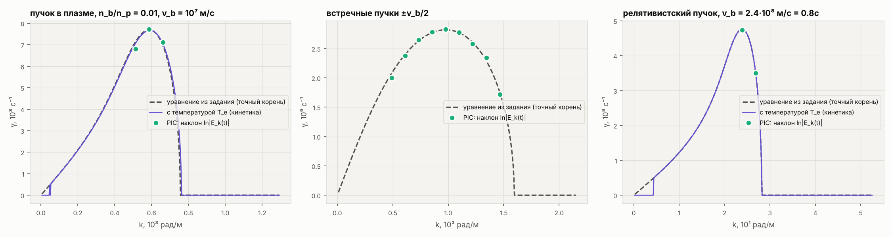

## E2. Таблица амплитуд насыщения от плотности пучка n_b/n_p

| n_b/n_p | γ теор, с⁻¹ | γ PIC, с⁻¹ | ошибка γ, % | t_sat, с | E_sat PIC, В/м | захват, В/м | отношение | ω_B/γ | W_E,sat, Дж/м³ | W_E,sat/K_b0 | невязка энергии |
|---|---|---|---|---|---|---|---|---|---|---|---|
| 0.001 | 3.714e+08 | 3.665e+08 | -1.31 | 2.27e-08 | 4401 | 4310 | 1.021 | 1.79 | 4.59e-05 | 0.101 | 3.9e-03 |
| 0.002 | 4.635e+08 | 4.584e+08 | -1.10 | 1.91e-08 | 6877 | 6675 | 1.030 | 1.79 | 1.09e-04 | 0.120 | 1.9e-03 |
| 0.005 | 6.186e+08 | 6.188e+08 | +0.04 | 1.54e-08 | 12411 | 11753 | 1.056 | 1.82 | 3.48e-04 | 0.152 | 8.2e-04 |
| 0.01 | 7.667e+08 | 7.721e+08 | +0.69 | 1.31e-08 | 19098 | 17796 | 1.073 | 1.83 | 8.29e-04 | 0.182 | 3.8e-04 |
| 0.02 | 9.467e+08 | 9.507e+08 | +0.42 | 1.12e-08 | 28875 | 26535 | 1.088 | 1.84 | 1.96e-03 | 0.215 | 2.3e-04 |
| 0.05 | 1.242e+09 | 1.246e+09 | +0.33 | 9.27e-09 | 48029 | 43566 | 1.102 | 1.86 | 5.70e-03 | 0.250 | 2.1e-04 |
| 0.1 | 1.516e+09 | 1.518e+09 | +0.17 | 7.94e-09 | 60731 | 61354 | 0.990 | 1.76 | 8.62e-03 | 0.189 | 3.7e-04 |

Степенные законы на интервале n_b/n_p = 0.001…0.1: **E_sat(PIC) ∝ (n_b/n_p)^0.583**, теория захвата с точным γ — показатель 0.579, γ_max ∝ (n_b/n_p)^0.306; предел слабого пучка — показатель 2/3 (γ ∝ (n_b/n_p)^(1/3), k ≈ const). Отношение E_sat/(3.12γ²m/(ek)) = 0.99…1.10: константа захвата в многомодовом PIC чуть больше, чем в одноволновой модели (ω_B/γ = 1.76…1.86 против 1.77).

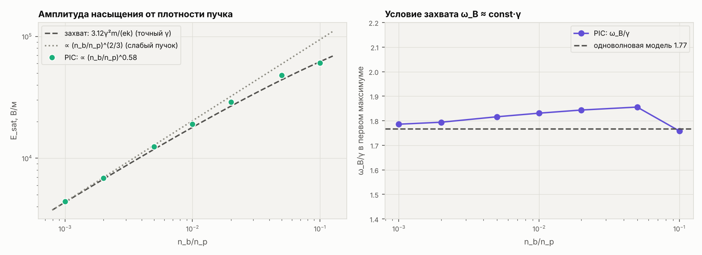

## E3. Скорость пучка v_b: от нерелятивистского до 0.9c (n_b/n_p = 0.01)

| v_b, м/с | v_b/c | γ_b | γ теор, с⁻¹ | γ PIC, с⁻¹ | ошибка γ, % | γ·γ_b/ω_p | E_sat, В/м | захват, В/м | отношение | ω_B/γ |
|---|---|---|---|---|---|---|---|---|---|---|
| 5.00e+06 | 0.017 | 1.000 | 7.551e+08 | 7.310e+08 | -3.19 | 0.1296 | 8.676e+03 | 8.620e+03 | 1.006 | 1.77 |
| 1.00e+07 | 0.033 | 1.001 | 7.667e+08 | 7.721e+08 | +0.69 | 0.1369 | 1.910e+04 | 1.780e+04 | 1.073 | 1.83 |
| 2.00e+07 | 0.067 | 1.002 | 7.677e+08 | 7.715e+08 | +0.49 | 0.1371 | 3.906e+04 | 3.583e+04 | 1.090 | 1.85 |
| 5.00e+07 | 0.167 | 1.014 | 7.598e+08 | 7.621e+08 | +0.29 | 0.1370 | 9.874e+04 | 9.038e+04 | 1.092 | 1.85 |
| 1.00e+08 | 0.334 | 1.061 | 7.290e+08 | 7.300e+08 | +0.13 | 0.1373 | 2.028e+05 | 1.861e+05 | 1.090 | 1.85 |
| 1.50e+08 | 0.500 | 1.155 | 6.736e+08 | 6.723e+08 | -0.20 | 0.1376 | 3.210e+05 | 2.949e+05 | 1.089 | 1.84 |
| 2.00e+08 | 0.667 | 1.342 | 5.852e+08 | 5.829e+08 | -0.39 | 0.1387 | 4.679e+05 | 4.330e+05 | 1.081 | 1.84 |
| 2.40e+08 | 0.801 | 1.669 | 4.763e+08 | 4.741e+08 | -0.45 | 0.1402 | 6.316e+05 | 5.952e+05 | 1.061 | 1.82 |
| 2.70e+08 | 0.901 | 2.301 | 3.501e+08 | 3.485e+08 | -0.46 | 0.1421 | 8.275e+05 | 8.070e+05 | 1.025 | 1.79 |

При v_b ≪ c скорость пучка — только масштаб: γ от v_b не зависит, k_max ∝ 1/v_b, **E_sat ∝ v_b^1.052**. При v_b → c в уравнении появляется релятивистская продольная масса mγ_b³: **инкремент падает как 1/γ_b** (столбец γ·γ_b/ω_p почти постоянен), а поле насыщения E_sat = 3.12γ²mγ_ф³/(ek) растёт быстрее, чем v_b. PIC-код с релятивистским уравнением движения воспроизводит обе зависимости.

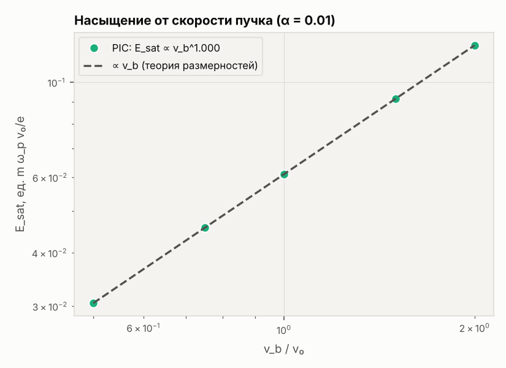

## E4. Тёплый пучок: кинетическая теория и переход к квазилинейному режиму

γ теор — корень кинетического уравнения ε(ω,k) = 0 с функцией Z (максвелловский пучок с разбросом скоростей Δv_b), для самой быстрой моды ящика.

| Δv_b, м/с | γ кинет., с⁻¹ | γ PIC, с⁻¹ | ошибка, % | E_sat, В/м | 3.12γ²m/(ek), В/м | ω_B/γ | W_E,sat/K_b0 | W_E,конец | W_E^КЛ |
|---|---|---|---|---|---|---|---|---|---|
| 0.0e+00 | 7.667e+08 | 7.721e+08 | +0.69 | 19098 | 17796 | 1.83 | 0.182 | 0.138 | 0.153 |
| 3.0e+05 | 7.425e+08 | 7.523e+08 | +1.32 | 18790 | 16686 | 1.88 | 0.174 | 0.127 | 0.153 |
| 6.0e+05 | 6.719e+08 | 6.677e+08 | -0.63 | 17749 | 13666 | 2.01 | 0.154 | 0.128 | 0.140 |
| 1.0e+06 | 5.361e+08 | 5.366e+08 | +0.11 | 15034 | 8698 | 2.32 | 0.110 | 0.119 | 0.127 |
| 1.5e+06 | 3.849e+08 | 3.840e+08 | -0.21 | — | 3985 | — | — | 0.133 | 0.152 |
| 2.0e+06 | 2.588e+08 | 2.591e+08 | +0.12 | — | 1802 | — | — | 0.113 | 0.139 |
| 2.5e+06 | 1.694e+08 | 1.803e+08 | +6.43 | — | 772 | — | — | 0.088 | 0.136 |

Граница гидродинамического режима Δv_b ≈ (n_b/2n_p)^(1/3)·v_b = 1.7·10⁶ м/с: при меньшем разбросе пучок ведёт себя как холодный (захват, ω_B/γ ≈ 1.8), при большем инкремент быстро падает, яркого первого максимума нет — волна растёт и насыщается плавно, как в квазилинейной теории.

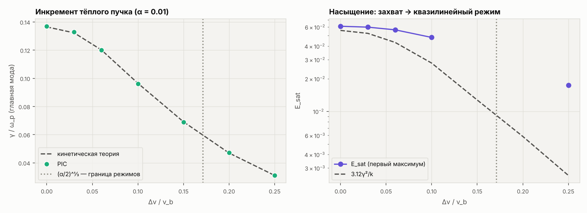

## E5. Сравнение с квазилинейной теорией насыщения

Квазилинейная теория: резонансные электроны пучка размазываются в плато f = const на [v₁, v₂]. Плотность энергии пучка с плато K_пл = n_b m (v₁² + v₁v₂ + v₂²)/6; отданная энергия K_b0 − K_пл уходит в ленгмюровские волны, половина её — электрическое поле: W_E^КЛ = (K_b0 − K_пл)/2. Края плато измеряются по f(v) на уровне половины высоты, W_E — среднее за последние 50/ω_p. Края плато берутся из самого счёта, поэтому это проверка баланса энергии, а не независимое предсказание.

| n_b/n_p | t_sat, с | t_конец, с | v₁, м/с | v₂, м/с | W_E/K_b0 PIC | W_E^КЛ/K_b0 | разница, % | W_E/K_b0 в максимуме |
|---|---|---|---|---|---|---|---|---|
| 0.002 | 1.91e-08 | 8.26e-08 | 4.96e+06 | 1.15e+07 | 0.128 | 0.143 | +12 | 0.120 |
| 0.005 | 1.54e-08 | 6.63e-08 | 3.85e+06 | 1.27e+07 | 0.107 | 0.127 | +19 | 0.152 |
| 0.01 | 1.31e-08 | 5.69e-08 | 2.22e+06 | 1.27e+07 | 0.162 | 0.176 | +9 | 0.182 |
| 0.02 | 1.12e-08 | 4.95e-08 | 1.95e+06 | 1.35e+07 | 0.114 | 0.144 | +26 | 0.215 |
| 0.05 | 9.27e-09 | 4.20e-08 | 1.13e+06 | 1.40e+07 | 0.051 | 0.143 | +179 | 0.250 |
| 0.1 | 7.94e-09 | 3.76e-08 | 2.37e+05 | 1.56e+07 | 0.004 | 0.086 | +1991 | 0.189 |

Полная квазилинейная релаксация холодного пучка в плато [0, v_b] дала бы W_E = K_b0/3 ≈ 0.333 — это верхняя оценка; за время счёта плато ещё не дошло до нуля скоростей. При n_b/n_p ≳ 0.1 энергия заметно уходит в нагрев электронов плазмы, и баланс «пучок ↔ волны» перестаёт выполняться — это результат, а не ошибка.

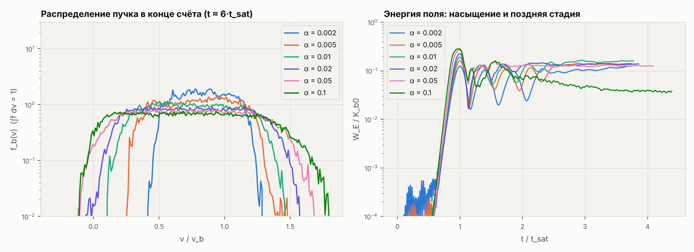

## E6. Погрешности и устойчивость численной схемы

Базовый расчёт: n_b/n_p = 0.01, Δt = 0.1/ω_p = 17.7 пс, N_g = 1024 (Δx = 83.6 мкм = 0.7 λ_D), N = 65 536; меняется один параметр. Невязка энергии — max |W_E + ΣK − const| за весь счёт в долях начальной плотности энергии пучка K_b0.

| вариант | γ PIC, с⁻¹ | ошибка γ, % | E_sat, В/м | ω_B/γ | невязка энергии | время счёта, с |
|---|---|---|---|---|---|---|
| ω_pΔt=0.05 | 7.720e+08 | +0.68 | 19102 | 1.83 | 5.3e-04 | 11 |
| ω_pΔt=0.1 | 7.721e+08 | +0.69 | 19098 | 1.83 | 3.8e-04 | 6 |
| ω_pΔt=0.2 | 7.729e+08 | +0.80 | 19090 | 1.83 | 1.3e-03 | 3 |
| ω_pΔt=0.4 | 7.753e+08 | +1.12 | 19054 | 1.83 | 5.6e-03 | 2 |
| N_g=256 | 7.650e+08 | -0.23 | 19270 | 1.84 | 5.0e-03 | 6 |
| N_g=512 | 7.711e+08 | +0.56 | 19149 | 1.83 | 7.3e-04 | 6 |
| N_g=1024 | 7.721e+08 | +0.69 | 19098 | 1.83 | 3.8e-04 | 6 |
| N_g=2048 | 7.737e+08 | +0.90 | 19081 | 1.83 | 9.2e-04 | 6 |
| N=8192 | 7.637e+08 | -0.40 | 19100 | 1.83 | 3.3e-03 | 1 |
| N=16384 | 7.726e+08 | +0.76 | 19133 | 1.83 | 1.1e-03 | 1 |
| N=32768 | 7.702e+08 | +0.45 | 19128 | 1.83 | 1.5e-03 | 2 |
| N=65536 | 7.721e+08 | +0.69 | 19098 | 1.83 | 3.8e-04 | 6 |
| N=131072 | 7.720e+08 | +0.69 | 19107 | 1.83 | 1.3e-04 | 13 |
| T_e=300 К | 7.697e+08 | +0.03 | 19549 | 1.85 | 3.7e-04 | 7 |
| T_e=3000 К | 7.724e+08 | +0.41 | 19581 | 1.85 | 1.8e-04 | 6 |
| T_e=30000 К | 7.721e+08 | +0.69 | 19098 | 1.83 | 3.8e-04 | 6 |
| T_e=100000 К | 7.948e+08 | +4.86 | 17833 | 1.79 | 6.5e-04 | 5 |

Схема «чехарда» устойчива при ω_pΔt < 2; при ω_pΔt = 0.4 ошибка частоты (ω_pΔt)²/24 ≈ 0.7 %. От температуры плазмы результат почти не зависит при T_e ≤ 3·10⁴ К; при T_e = 10⁵ К (v_b/v_Te = 8) расхождение γ с теорией вырастает до 5 % (причина не выяснялась). Невязка энергии везде меньше 1 % K_b0.

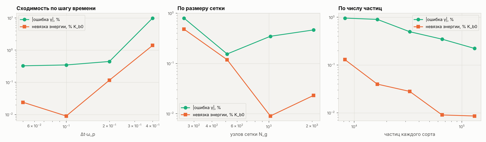

## E7. Одноволновая модель: универсальная константа насыщения

Модель огибающей: dÊ/dt = (e·n_b·ω_p/(ε₀k))⟨e^(−iψ)⟩, dψ/dt = kv − ω_p, dp/dt = −e·Re(Ê e^(iψ)); РК4, 4096 частиц. При kv_b = ω_p и v_b ≪ c все параметры убираются масштабированием, поэтому (ω_B/γ)² = e·k·E_sat/(mγ²) — одно и то же число при любых n_b/n_p, n_p и v_b. У релятивистского пучка константа уменьшается: захваченные электроны в системе волны уже не медленные (параметр Тоде–Судана S = (v_b/c)²γ_b(n_b/2n_p)^(1/3) не мал).

| n_b/n_p | v_b, м/с | n_p, м⁻³ | γ_b | (ω_B/γ)² | ω_B/γ | γ·t_sat |
|---|---|---|---|---|---|---|
| 0.001 | 1.0e+07 | 1e+16 | 1.001 | 3.1231 | 1.7672 | 13.76 |
| 0.01 | 1.0e+07 | 1e+16 | 1.001 | 3.1227 | 1.7671 | 15.29 |
| 0.1 | 1.0e+07 | 1e+16 | 1.001 | 3.1219 | 1.7669 | 16.82 |
| 0.01 | 3.0e+06 | 1e+11 | 1.000 | 3.1234 | 1.7673 | 15.29 |
| 0.01 | 1.0e+08 | 1e+16 | 1.061 | 3.0352 | 1.7422 | 15.30 |
| 0.01 | 2.0e+08 | 1e+16 | 1.342 | 2.7005 | 1.6433 | 15.35 |
| 0.01 | 2.7e+08 | 1e+16 | 2.301 | 2.0185 | 1.4207 | 15.40 |

## E8. Подвижные ионы: каверны (солитоны) и поглощение ленгмюровских волн

Длинные счёты до t = 355 нс = 2005/ω_p. Ионы — частицы с настоящей массой (H⁺: m_i/m_e = 1836; Ar⁺: 72 820), T_i = 3·10³ К. W = ε₀⟨E²⟩/(2n k_BT_e) — уровень поля (отношение плотности энергии поля к тепловой энергии электронов).

| счёт | m_i/m_e | n_b/n_p | t_sat, с | начало каверн t, с | то же, 1/ω_p | W в пике | δn_i/n_i в точке пика | min δn_i/n_i | W_E/K_b0 в максимуме | W_E/K_b0 в конце | невязка энергии |
|---|---|---|---|---|---|---|---|---|---|---|---|
| ионы неподвижны | — | 0.01 | 1.31e-08 | — | — | 0.86 | +0.000 | +0.000 | 0.182 | 0.1151 | 3.8e-04 |
| ионы H⁺ | 1836 | 0.01 | 1.31e-08 | 9.75e-08 | 550 | 0.98 | -0.084 | -0.254 | 0.182 | 0.0094 | 4.0e-04 |
| ионы H⁺, n_b/n_p = 0.03 | 1836 | 0.03 | 1.03e-08 | 8.33e-08 | 470 | 1.22 | +0.012 | -0.148 | 0.234 | 0.0039 | 2.6e-04 |
| ионы Ar⁺ | 72820 | 0.01 | 1.31e-08 | — | — | 0.87 | -0.000 | -0.012 | 0.182 | 0.1077 | 3.7e-04 |

**Что происходит.** После насыщения ленгмюровская волна своим высокочастотным давлением (пондеромоторной силой) выталкивает плазму из областей сильного поля. Возмущения концентрации ионов растут примерно экспоненциально, средний темп 3.8·10⁷ с⁻¹. Для сравнения: линейная теория модуляционной неустойчивости (уравнения Захарова) для одной волны с уровнем поля W₀ = 0.15, измеренным в этом же счёте, даёт γ_мод = 4.8·10⁷ с⁻¹. Это согласие по порядку величины: в счёте не одна волна, а пакет волн с захваченными частицами, и W₀ меняется со временем. В ямах концентрации плазменная частота ниже — поле запирается в них: образуются **каверны** (в пике W = 0.98, концентрация в этой точке -8 %). Каверна сжимается до нескольких λ_D, энергия поля падает в 19 раз относительно максимума (без ионов — только в 1.6 раза) и переходит в нагрев электронов плазмы (вероятный механизм — затухание Ландау коротких волн в каверне; отдельно он не проверялся). С тяжёлыми ионами Ar⁺ за время счёта каверны не успевают образоваться.

Оговорки: (1) шум макрочастиц в PIC на несколько порядков больше реального теплового шума плазмы, поэтому каверны появляются раньше, чем в установке; (2) момент «начала каверн» — условная граница: среднеквадратичное δn_i/n_i > 2 %.

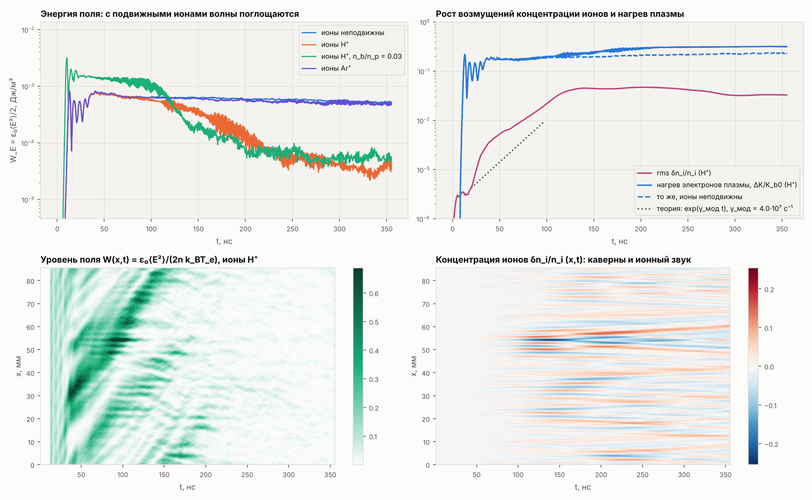

## E9. Уравнения огибающей с нелинейным сдвигом частоты (уравнения Захарова)

Второе прочтение подсказки задания. i∂Ẽ/∂t + (3v_Te²/2ω_p)∂²Ẽ/∂x² = (ω_p/2)(δn/n)Ẽ; ∂²(δn/n)/∂t² − c_s²∂²(δn/n)/∂x² = (ε₀/4n m_i)∂²|Ẽ|²/∂x². Псевдоспектральный метод расщепления, 1024 узла, Δt = 0.5/ω_p, плазма та же (ионы H⁺).

**(а) Точный солитон** Ẽ = E_m sech((x − Vt)/Δ): за 2000/ω_p форма и скорость сохраняются.

| W_m | V/c_s | E_m, В/м | Δ теория, м | Δ счёт (t=0), м | Δ счёт (конец), м | δn/n теория | W_m в конце | V счёт, м/с | V теория, м/с | ΔN/N |
|---|---|---|---|---|---|---|---|---|---|---|
| 0.01 | 0.0 | 4326 | 3.338e-03 | 3.338e-03 | 3.338e-03 | -0.0077 | 0.0100 | 0 | 0 | 8e-13 |
| 0.05 | 0.0 | 9673 | 1.493e-03 | 1.493e-03 | 1.493e-03 | -0.0385 | 0.0500 | 0 | 0 | 5e-13 |
| 0.05 | 0.5 | 9673 | 1.293e-03 | 1.293e-03 | 1.293e-03 | -0.0513 | 0.0500 | 8960 | 8971 | -8e-12 |
| 0.1 | 0.3 | 13679 | 1.007e-03 | 1.008e-03 | 1.008e-03 | -0.0845 | 0.1000 | 5423 | 5383 | -1e-08 |

**(б) Модуляционная неустойчивость** однородной волны: рост возмущения концентрации сравнивается с корнем многочлена 4-й степени (Ω² − c_s²q²)[(Ω − qV_g)² − δ²] = W₀(k_BT_e/m_i)q²ω_pδ.

| W₀ | k₀λ_D | q, рад/м | γ_мод теория, с⁻¹ | γ_мод счёт, с⁻¹ | ошибка, % |
|---|---|---|---|---|---|
| 0.01 | 0.0 | 367 | 7.277e+06 | 7.277e+06 | -0.00 |
| 0.02 | 0.07 | 1101 | 1.912e+07 | 1.912e+07 | -0.01 |
| 0.1 | 0.07 | 1321 | 4.001e+07 | 4.001e+07 | +0.00 |

**(в)** Волна с уровнем W₀ = 0.1 (как после насыщения пучковой неустойчивости при n_b/n_p = 0.01) за ~1000/ω_p распадается на каверны — всплески поля в ямах концентрации. Каверна в момент снимка ещё сжимается: она шире стационарного солитона sech² той же высоты (пунктир, Δ = λ_D√(6τ/W_m)) и яма мельче, чем −W_m/τ. Та же картина видна в PIC-счёте с подвижными ионами (E8) — два независимых метода дают качественно одно и то же.

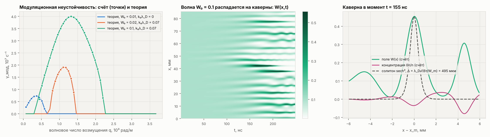

## Иллюстрации

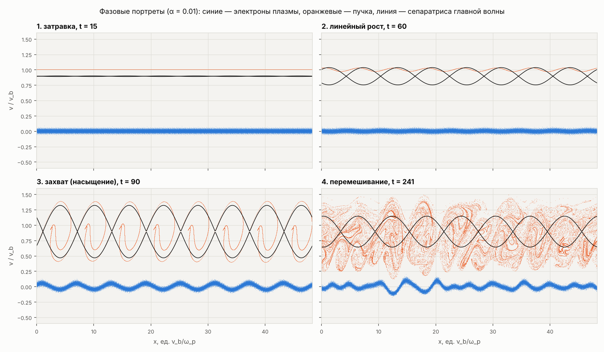

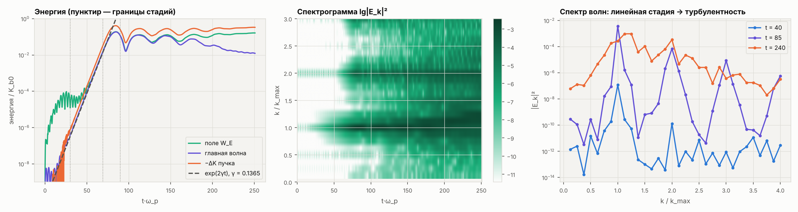

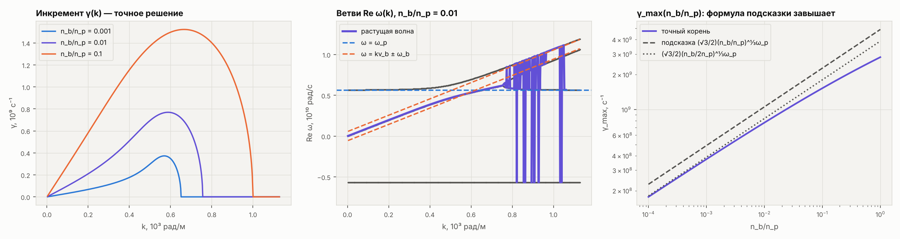

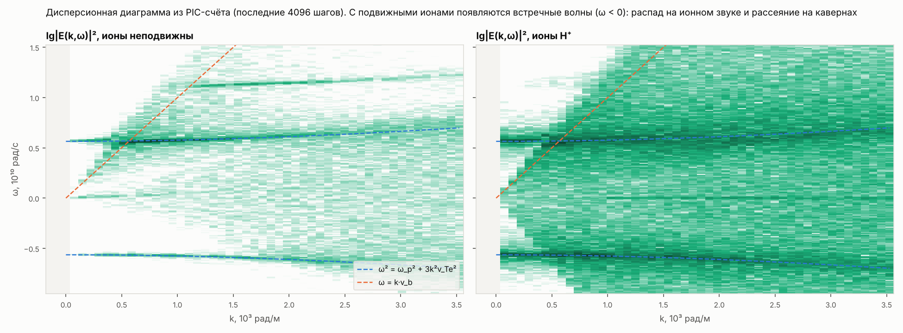

_Полное время всех расчётов: 239 с._
